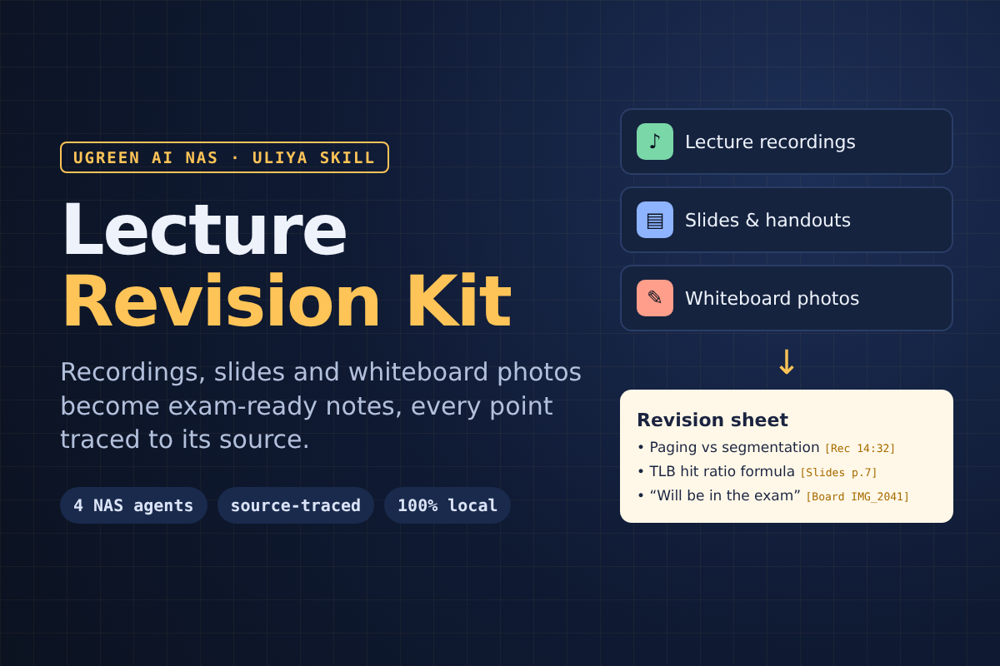

# Lecture Revision Kit



A Uliya Skill for UGREEN AI NAS that turns one course's lecture recordings,
slides and handouts, and whiteboard photos into one note per lecture plus an
exam revision sheet. Every point is traced back to its source (recording time,
slide page, or photo file name).

Entry for the **UGREEN Hackathon 2026 on AI NAS**, track *Automate Your Workflow*.

## How it works

| Step | Expert | Capability |
|---|---|---|
| Find the course's recordings, documents and photos | `file-agent` | `ug-filesystem` |
| Transcribe lecture recordings | `knowledge-agent` | `ug-knowledge` |
| Read text from whiteboard photos | `photo-agent` | `ug-photo` |
| Outline slides, draft notes and the revision sheet | `document-agent` | `ug-document` |
| Save notes after the user confirms | `knowledge-agent`, `file-agent` | `ug-knowledge`, `ug-filesystem` |

Original files are never moved, edited or deleted. New notes are saved only
after confirmation and never overwrite existing files.

## Repository layout

```
skill/lecture-revision-kit/   the Skill (this is what gets submitted)
  SKILL.md                    entry point: goal, inputs, workflow, failure handling
  references/user-guide.md    user guide
  references/disclosures.md   third-party, license and AI tool disclosures
assets/                       Devpost thumbnail (1200x800)
Makefile                      check and package helpers
```

## Check and package

Requires Node.js and the official UGOS Skill Creation Tool (`uliya-skill-kit`)
installed in your AI assistant's skills folder.

```
make check     # run the official static checker
make package   # build dist/lecture-revision-kit.zip for Round 1
```
